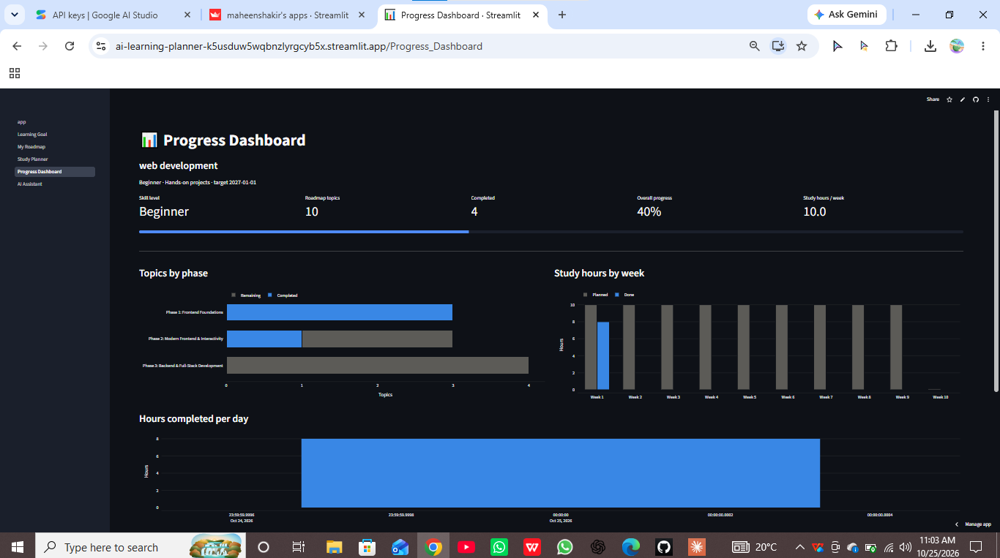

# 🎓 AI Personalized Learning Planner

An AI-powered study planner built with Streamlit. Tell it what you want to learn, your level, and how much time you have, and it creates a personalized roadmap, a realistic weekly schedule, and a dashboard to track your progress.

**🔗 Live demo:** https://ai-learning-planner-k5usduw5wqbnzlyrgcyb5x.streamlit.app

   Note: This is a demo app. Each visitor gets a private workspace tied to their browser link, but saved data may reset when the app restarts. A cloud database is planned for a future version
   
   

## ✨ Features

- **Learning goal form:** goal, skill level, study hours per day, study days per week, target date, and learning style.
- **AI-generated roadmap:** phases, topics, descriptions, time estimates, practice exercises, mini-projects, and free resources, ordered from foundations to advanced.
- **Weekly study planner:** spreads the roadmap over real calendar days and never schedules more than your daily study hours.
- **AI learning assistant:** a chat tutor that knows your goal and level and can explain concepts, suggest exercises, resources, and project ideas.
- **Progress tracking:** tick off topics and study sessions; progress is saved in SQLite.
- **Dashboard:** overall progress, topics by phase, planned vs. completed hours per week, upcoming tasks, and remaining topics (Plotly charts).

## 🛠️ Tech Stack

| Area | Tools |
|---|---|
| App framework | Streamlit |
| Data | Pandas, SQLite |
| Charts | Plotly |
| AI | Google Gemini API (`google-genai`) |
| Language | Python |

## 📁 Project Structure

```
ai-learning-planner/
├── app.py                      # Home page
├── requirements.txt
├── .streamlit/config.toml      # Dark theme
├── pages/
│   ├── 1_Learning_Goal.py
│   ├── 2_My_Roadmap.py
│   ├── 3_Study_Planner.py
│   ├── 4_Progress_Dashboard.py
│   └── 5_AI_Assistant.py
└── src/
    ├── database.py             # SQLite tables and queries
    ├── ai_assistant.py         # Gemini connection (with retry and backup models)
    ├── roadmap_generator.py    # Prompt, JSON parsing, hour scaling
    └── study_planner.py        # Schedule builder
```

## 🚀 Run Locally

```bash
git clone https://github.com/MaheenShakir/AI-Learning-Planner.git
cd AI-Learning-Planner
python -m venv venv
# Windows: venv\Scripts\activate   |   Mac/Linux: source venv/bin/activate
pip install -r requirements.txt
```

Get a free API key from [Google AI Studio](https://aistudio.google.com/apikey), then set it:

```bash
# Windows (PowerShell)
$env:GEMINI_API_KEY="your_key_here"
# Mac/Linux
export GEMINI_API_KEY="your_key_here"
```

Start the app:

```bash
streamlit run app.py
```

## ☁️ Deploy on Streamlit Community Cloud

1. Push this repo to GitHub.
2. On [share.streamlit.io](https://share.streamlit.io), create an app with `app.py` as the main file.
3. In **Settings → Secrets**, add:
   ```
   GEMINI_API_KEY = "your_key_here"
   ```

API keys are read from secrets or environment variables and are never stored in the code.

## 🧠 How It Works

1. Your answers are saved as a goal in SQLite.
2. The roadmap prompt includes your goal, level, learning style, and the total hours you can study before your target date. The AI's JSON reply is validated, and topic hours are scaled down if they exceed your available time.
3. The schedule builder fills each study day up to your daily hours, splitting large topics across days.
4. Every checkbox writes to the database, so the dashboard always shows current progress.

## 🔮 Future Improvements

- Persistent cloud database (the free hosting tier can reset local files)
- User accounts
- Export the roadmap to PDF
- Reminders and streak tracking

## 👩‍💻 Author

**Maheen Shakir**, Data Science student.
